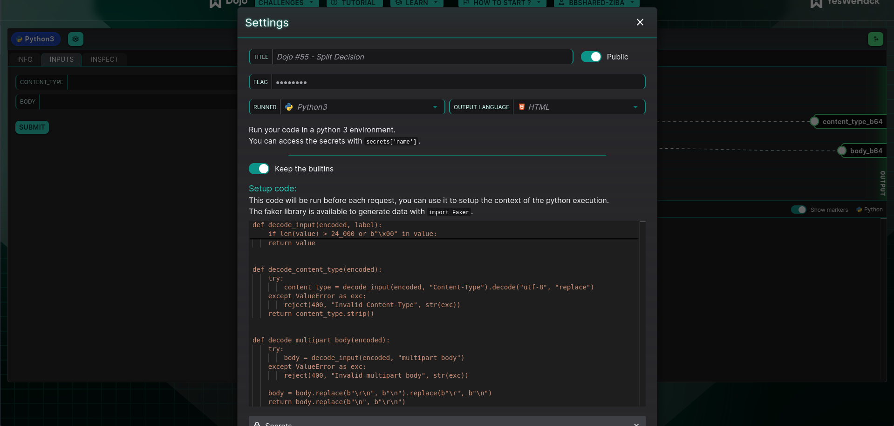
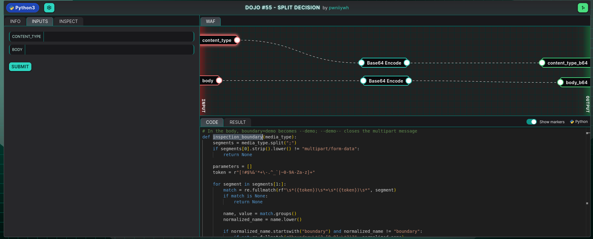
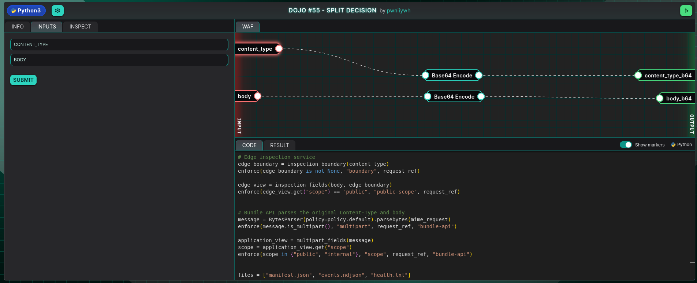
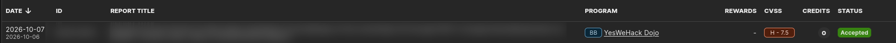

Most of the bugs I enjoy the most are not about finding a secret input. They are
about two pieces of code looking at the exact same bytes and disagreeing on what
those bytes mean. [Dojo #55](https://dojo-yeswehack.com/challenge-of-the-month/dojo-55),
called "Split Decision," is one of those, and the name is basically the solution
written on the box. After [last month's challenge](/blog/posts/yeswehack-dojo-54-highscore)
turned on a byte-versus-character length mismatch, this one scratched the same
itch from a different angle: a parser differential hiding in a multipart
`Content-Type`.

> [!NOTE] TL;DR
> A diagnostic bundle passes through a validating gateway before an export
> service acts on it. The gateway reads the multipart boundary with a hand-rolled
> regex that only honors a plain `boundary=`. The export service re-parses the
> same header with Python's `email` module, which implements RFC 2231 and
> assembles `boundary*0=`. Put `boundary*0=bbbb` *before* `boundary=aaaa`, and the
> two layers split the body on different delimiters: the gateway sees
> `scope=public` and forwards the request, while the export service sees
> `scope=internal` and hands back the token.

> [!NOTE] How I Used AI
> This one was hard for me, and a lot of my understanding of it came from
> working through it with AI. I leaned on it to make sense of the two parsers,
> to read RFC 2231 properly, and to see why the parameter ordering mattered. The
> words here are mine, but the understanding behind them was not all my own this
> time.

## The shape of the thing

The setup is a two-stage pipeline, and I control two inputs: a `Content-Type`
header value and a multipart body. The request goes to
`POST /v1/support/bundles/preview`, and this is what happens to it:

1. An **edge gateway** pulls the multipart boundary out of the `Content-Type`,
   parses the body with that boundary, and forwards the request only if it reads
   a field `scope=public`. The idea is that only redacted, public bundles are
   allowed to leave the support network.
2. An **export service** then re-parses the original header and body on its own.
   If it reads `scope=internal`, the response it builds includes a privileged
   bundle, and that bundle carries `SUPPORT_EXPORT_TOKEN`.



Both inputs arrive base64-encoded, and this setup code is all that touches them
before the parsers do. `decode_content_type` and `decode_multipart_body` just
turn them back into raw bytes and normalize the line endings. Nothing here reads
the boundary or makes a security decision, so both stages downstream receive the
exact same bytes. That is the premise the whole challenge rests on: the bug is
never in what arrives, only in how two different parsers read identical input.

Reading that, I did not go looking for a way to smuggle a weird character past a
filter. The interesting words were "both layers," and the win condition almost
wrote itself: I need the gateway to see `scope=public` so it forwards the
request, and the export service to see `scope=internal` so it leaks the token,
and I need both of those to be true of one request at the same time. If I can
make the two stages read the body differently, I win.

## Reading how each layer reads

Two stages, two chances to parse the boundary differently. So the first thing I
did was find where each one actually decides what the boundary is.

The gateway uses its own parser, a regex that walks the `Content-Type`
parameters. One part of it stopped me:

```python
if normalized_name.startswith("boundary") and normalized_name != "boundary":
    if not re.fullmatch(r"boundary\*(?:[0-9]+\*?)?", normalized_name):
        return None

for name, value in parameters:
    if name.lower() != "boundary":
        continue
    if not re.fullmatch(r"[A-Za-z0-9._-]{1,70}", value):
        return None
    return value.encode("ascii")
```



This is the first half of the vulnerability: a hand-rolled boundary parser. It
splits the `Content-Type` on `;` and walks the parameters with a regex instead
of using a real MIME parser. That is what gives it room to disagree with the
library parser waiting on the other side.

Look at what that does. The first block goes out of its way to *accept*
parameters like `boundary*0`, `boundary*1`, `boundary*0*`, the RFC 2231
continuation forms. Then the selection loop below it only ever returns a value
whose name is exactly `boundary`. So the gateway tolerates those `boundary*`
parameters and then completely ignores them. Code that carefully permits
something it never uses is usually trusting someone else to deal with it, and
that someone else is the export service, which parses with Python's standard
library:

```python
edge_boundary = inspection_boundary(content_type)                     # gateway regex
enforce(edge_view.get("scope") == "public", "public-scope", request_ref)

message = BytesParser(policy=policy.default).parsebytes(mime_request)  # Python email
scope = application_view.get("scope")
```



This is the whole bug in six lines, and it is the second half of the
vulnerability. The edge gateway decides with `inspection_boundary` and demands
`scope == "public"`. The Bundle API then re-parses the *same, untouched* request
with `BytesParser(policy=policy.default)` and reads its own `scope`. The request
that gets approved and the request that gets acted on are never parsed by the
same code, so they can be made to hold two different scopes at once.

Python's `email` module, under `policy.default`, implements RFC 2231 properly. It
understands those `boundary*0=` continuations and assembles them into the real
boundary. That is the entire bug in one sentence: the gateway pretends to
understand a parameter that the export service takes seriously. Hand them both a
plain `boundary=` and an RFC 2231 one, and they will pick different boundaries,
and then they will cut the body in different places.

## Not trusting the hunch

A theory about parser behavior is worth very little until you have run both
parsers on the same input and watched them disagree. So I did exactly that:
pulled the gateway's `inspection_boundary` function out verbatim, stood Python's
`email` parser next to it, and fed them candidate headers.

The one that mattered:

```text
multipart/form-data; boundary*0=bbbb; boundary=aaaa
   gateway -> aaaa
   python  -> bbbb
```

There it was. One header, two boundaries. The gateway reads `aaaa`, Python reads
`bbbb`.

The detail I would never have guessed without running it is that **order
matters**. The continuation has to come *before* the plain parameter. If I write
`boundary=aaaa; boundary*0=bbbb` instead, Python quietly falls back to the plain
value, both sides agree on `aaaa`, and the split vanishes. That little asymmetry
in how `email` prefers a sectioned parameter over a plain one, depending on where
it appears, is the real heart of the challenge. Everything else is plumbing.

## Letting each layer read its own story

Once I had two boundaries, the body was just staging. Multipart parsers ignore
anything before the first delimiter (the preamble) and anything after the closing
delimiter (the epilogue). That is the lever: I can let each parser's ignored
region be the other parser's real content.

Here is the body I landed on:

```text
--aaaa
Content-Disposition: form-data; name="scope"

public
--aaaa--
--bbbb
Content-Disposition: form-data; name="scope"

internal
--bbbb--
```

Trace it through the gateway first. It splits on `--aaaa`. It sees one part with
`name="scope"` and a value of `public`, then `--aaaa--` closes the message. The
entire `--bbbb` block underneath is epilogue, so the gateway never looks at it.
As far as the gateway is concerned, this is a clean, public bundle, and it
forwards the request.

Now trace it through the export service. It splits on `--bbbb`. Everything above
the first `--bbbb`, including the whole `--aaaa` part that said `public`, is
preamble, so it is discarded. The export service sees one part with
`name="scope"` and a value of `internal`.

Same bytes. Each layer confidently reads the half that was written for it.

## Watching it pay off

With the two inputs in hand:

**Content-Type**

```text
multipart/form-data; boundary*0=bbbb; boundary=aaaa
```

**Body**

```text
--aaaa
Content-Disposition: form-data; name="scope"

public
--aaaa--
--bbbb
Content-Disposition: form-data; name="scope"

internal
--bbbb--
```

The gateway waves it through as a public export, the export service builds an
internal one, and the response comes back with the scope flipped and redaction
switched off:

```text
scope: "internal"
redaction: "disabled"
preview.runtime.env:
  SUPPORT_EXPORT_TOKEN=FLAG{Spl1t_Fl4gG3d_C00l_RFC_r1gH7_?}
```

There is the token, sitting in the runtime environment of a bundle that was never
supposed to leave the network.


## The fix

The fix is the boring, correct one, which is usually how these go. The real
problem is that the component that *approves* a request and the component that
*acts* on it parse that request with two different parsers, so they can be made
to disagree. Close the gap and the bug has nowhere to live:

- Parse the `Content-Type` and body exactly once, with a single RFC-compliant
  parser, and use that one result for both the policy check and the action.
- Reject duplicated or sectioned (`boundary*`) boundary parameters outright,
  rather than politely accepting them and then ignoring them.

A security check is only as good as the guarantee that the thing you inspected is
the thing that runs. The moment a second parser gets a second opinion, the check
is advisory at best.

## The intended solution

After I solved it, the challenge authors shared the payload they had in mind, and
it is worth showing, because it reaches the same split through a different door.
Where I used RFC 2231's *continuation* syntax (`boundary*0=`), the intended
solution uses its *extended-value* syntax, `boundary*=charset'language'value`:

**Content-Type**

```text
multipart/form-data; boundary*=us-ascii''i; boundary=p
```

**Body**

```text
--p
Content-Disposition: form-data; name="scope"

public
--p--
--i
Content-Disposition: form-data; name="scope"

internal
--i--
```

Here `boundary*=us-ascii''i` makes Python's `email` parser select `i`, while the
gateway ignores the extended parameter and falls back to the plain `boundary=p`
(RFC 2231, Section 4). It is the same bug from the same seam: the gateway
tolerates a `boundary*` parameter it never uses, and Python takes it seriously.
Mine reached that seam through the continuation form instead, and I was glad it
worked, but theirs is the cleaner demonstration of the idea.

## Disclosure

I wrote this up and reported it to the YesWeHack Dojo program, where it was
triaged and accepted at CVSS 7.5 (High).



It also picked up points for report quality, which is always a good feeling.


## What I took away

The lesson I keep from this one is that "both layers" is a tell. Whenever a
request is validated by one component and then executed by another, I now assume
the two can be made to disagree until I have proven otherwise, because the bug
lives in the seam between them and not in either parser alone. What points me at
that seam is usually a smaller detail: a parser that carefully accepts something
it never uses. The gateway went out of its way to permit `boundary*` parameters
and then ignored them, and that single bit of politeness was the whole map. It
meant someone downstream was expected to deal with them, and that someone was
Python's `email` module reading RFC 2231.

The rest of what I am taking away is about method more than about MIME. I would
have gotten the ordering backwards if I had only argued it in my head; printing
the two boundaries side by side settled it in seconds, and the part that
surprised me, that the order of the parameters matters, only surfaced because I
ran the parsers instead of reasoning about them. Once they disagreed, the body
was the easy part. In a boundary-confusion bug the preamble and epilogue are free
real estate, because the bytes one parser throws away are exactly where you hide
the content meant for the other.
